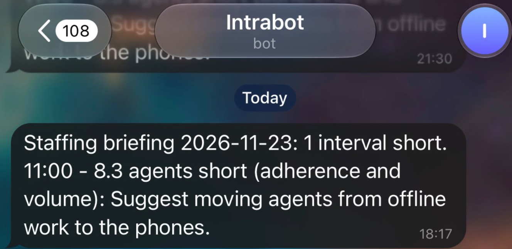
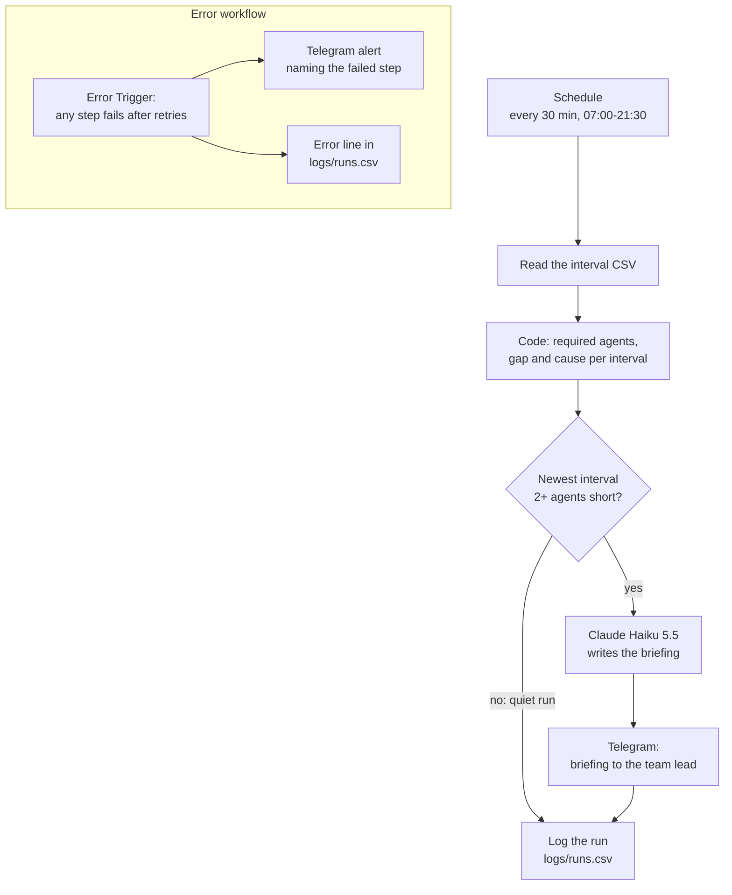
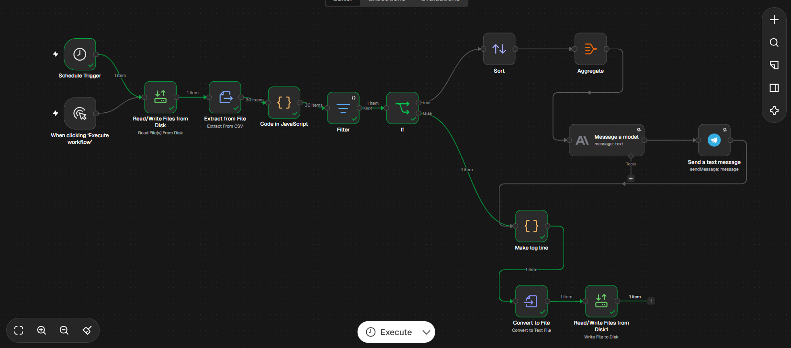
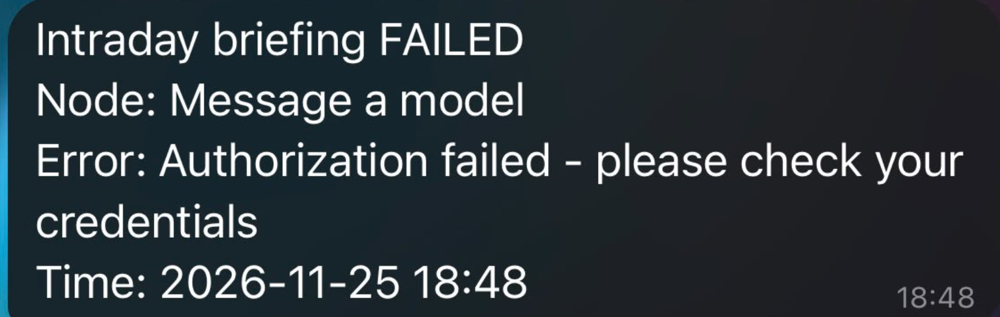

# n8n Intraday Staffing Briefing

An n8n workflow that checks a contact centre's intraday numbers every 30 minutes, spots when the
newest interval is short of agents, has Claude write a two-line briefing with a suggested action,
and sends it to the team lead on Telegram.

> **All data in this repo is synthetic.** It is generated by `scripts/make_intraday_data.py` and
> does not come from any real company, client or tool.



```
Staffing briefing 2026-11-23: 1 interval short.
11:00 - 8.3 agents short (adherence and volume): Suggest moving agents from offline work to the phones.
```

## Why

In a contact centre, an interval that is short of agents hurts service within minutes. Workforce
management teams usually find these gaps by checking intraday reports by hand, often after the
interval is over. This workflow does the check on a schedule, explains the cause in plain words,
and leaves the decision to a person.

## What it does

1. **Runs every 30 minutes** from 07:00 to 21:30, or on demand.
2. **Calculates** the agents each interval needed, the gap, and the cause: agents missing
   (adherence), more contacts than forecast (volume), or both.
3. **Flags the newest interval** if it is 2 or more agents short, so each problem is reported once.
4. **Asks Claude** (Haiku 5.5) for a short briefing, using only the flagged numbers and a fixed
   prompt. Quiet runs skip Claude and Telegram entirely.
5. **Sends the briefing to Telegram.** The suggested action is a suggestion; the team lead decides.
6. **Logs every run** to a CSV file, and **sends an alert** naming the failed step if anything breaks.

## How it works





**The calculation**, for the 11:00 interval in the sample data:

| Step | 11:00 |
|---|---|
| Contacts | Forecast 150, actual 180. That is over 110% of forecast, so **volume** is a cause. |
| Agents | Scheduled 30, logged in 27. Three are missing, so **adherence** is a cause. |
| Agents needed | 180 contacts x 300 s handling time / 1800 s per interval / 0.85 occupancy = **35.3** |
| Gap | 27 logged in - 35.3 needed = **8.3 agents short** |

The 0.85 is target occupancy: agents can't be busy every second, so the workflow plans for 85%.

## Design choices

- **Claude only sees the flagged rows**, never the whole day. Less data in the prompt means lower
  cost, and nothing for the model to misread.
- **The numbers come from code, the words from Claude.** The prompt forbids recalculating or
  inventing numbers and gives one fixed action per cause. The prompt is versioned in
  [`prompts/briefing.md`](prompts/briefing.md), with a change log of what each version fixed.
- **A person decides.** The briefing suggests; the team lead acts.
- **Cost stays near zero.** A briefing uses about 570 input and 60 output tokens, roughly
  $0.0001. Quiet runs don't call Claude at all, and each call has a 1500-token cap.
- **Failures are visible.** Claude and Telegram get 3 tries each, 5 seconds apart. If a step still
  fails, a separate error workflow sends a Telegram alert naming it.
- **Every run is logged**, including failed ones, so cost and reliability can be checked later.
  Example lines:

  ```
  run_time,status,newest_interval,flagged,sent,input_tokens,output_tokens,error_node
  2026-11-25T18:28:49+01:00,ok,10:00,0,no,0,0,
  2026-11-25T18:48:11+01:00,error,,,no,,,Message a model
  2026-11-25T19:00:13+01:00,ok,11:00,1,yes,574,63,
  ```

  `python scripts/summarise_log.py` turns the log into runs, briefings sent, errors by step,
  tokens and cost.



*The alert from a test where I broke the API key on purpose.*

## What broke, and what I learned

| What happened | Why | Fix |
|---|---|---|
| Claude returned an empty reply | The model thinks before answering, and thinking counts toward the token limit. 400 tokens were all used up. | Raised the cap to 1500 |
| The briefing sometimes gave two actions | The prompt offered actions joined by "or" | Prompt v3: one fixed action per cause |
| Quiet runs crashed at the Sort step | When nothing is flagged, n8n passes on one empty item, and Sort needs a gap field | Moved the "anything flagged?" check before Sort |
| The schedule never fired | In n8n 2.x, saving a workflow is not publishing it | Published the workflow |
| Token counts were missing from the log | n8n's "Simplify Output" drops the usage data | Turned it off |
| The error alert never fired in tests | Error workflows only run for scheduled runs, not manual ones | Tested with a scheduled run and a fake API key |
| The log said "sent" only by luck | The log step was wired after Claude instead of after Telegram | Wired it after Telegram |

## A second workflow, built through MCP

After building everything by hand, I connected Claude Code to my local n8n through the community
[n8n-mcp](https://github.com/czlonkowski/n8n-mcp) server and had it build a small second workflow:
a nightly summary of the run log, sent to Telegram (`workflows/stage-7-daily-summary.json`).

- Claude created all 5 nodes in one step, validated them, and the workflow worked on the first run,
  13 minutes after installing n8n-mcp, setup included.
- I still did the chat ID, the first run, publishing and the export by hand. The n8n API key stayed
  in a Windows environment variable, never in a file.
- It was fast because building by hand had already solved the hard parts: file access, timezone,
  empty items, retries, publishing. Validation checks structure, not facts.

The full comparison and setup are in [`docs/stage-7-mcp.md`](docs/stage-7-mcp.md).

## Run it yourself

You need Windows with PowerShell, Node.js 20.19 to 24.x, Python 3, an Anthropic API key (set a
monthly spend limit) and a Telegram bot from @BotFather.

1. Install n8n. npm 12 blocks install scripts by default, so allow the ones n8n needs:
   ```powershell
   npm install -g n8n --allow-scripts=@parcel/watcher,isolated-vm,sqlite3,agent-browser,oracledb,protobufjs,msgpackr-extract,ssh2,@sentry/node-native-stacktrace,@sentry/node-cpu-profiler,cpu-features,@scarf/scarf
   ```
2. Clone this repo, generate the data, and start n8n. The start script only lets n8n's file nodes
   use the project's `data` and `logs` folders.
   ```powershell
   python scripts/make_intraday_data.py
   .\start-n8n.ps1
   ```
3. Open http://localhost:5678 and import `workflows/stage-5-reliable.json` (main) and
   `workflows/stage-5-errors.json` (error alerts).
4. Create an Anthropic credential and a Telegram credential in n8n, and select them in the nodes.
   Keys and tokens live only in n8n, never in this repo.
5. Fill in the placeholders: your Telegram chat ID instead of `YOUR_TELEGRAM_CHAT_ID` in both
   Telegram nodes, and your project folder instead of `C:\path\to\n8n-intraday` in the file nodes.
6. In the main workflow's settings, choose the error workflow as its **Error Workflow**, and set
   your timezone in both workflows.
7. Test it: `python scripts/make_intraday_data.py --interval 11:00` makes a file where the newest
   interval is short, so a manual run sends a briefing. `--interval 10:00` makes a quiet one.
8. Publish both workflows so the schedule runs.

Optional: import `workflows/stage-7-daily-summary.json` for a nightly summary of the run log in
Telegram (fill in the same two placeholders).

Checks: `node scripts/staffing_gap.test.js`, `node scripts/log_line.test.js` and
`node scripts/daily_summary.test.js` test the Code-node logic outside n8n. After exporting a
workflow, `python scripts/clean_export.py` replaces the chat ID and local path with placeholders
before it is committed.

## Repo layout

```
workflows/   n8n exports, one per build stage (stage-5-* is the finished version, stage-7 the MCP-built one)
scripts/     data generator, Code-node JavaScript with tests, log summary, export cleaner
prompts/     the Claude prompt, versioned with a change log
data/        the synthetic interval file
docs/        build plan and screenshots
start-n8n.ps1  starts n8n with file access limited to data/ and logs/
```

Each build stage has its own export in `workflows/`, so you can follow how the workflow grew:
hello world (1), finding the gaps (2), adding Claude (3), schedule and Telegram (4), reliability (5),
and a second workflow built through MCP (7).

## Built with

n8n 2.x (self-hosted), Claude Haiku 5.5 through the Anthropic API, Telegram Bot API, JavaScript,
Python. I built and tested every node of the main and error workflows in the n8n canvas myself, with
Claude Code as a pair: it explained each n8n concept, wrote the Code-node JavaScript, scripts and
docs, and handled Git. The Stage 7 summary workflow is the exception: Claude Code built it through
n8n-mcp, so I could compare the two ways.
